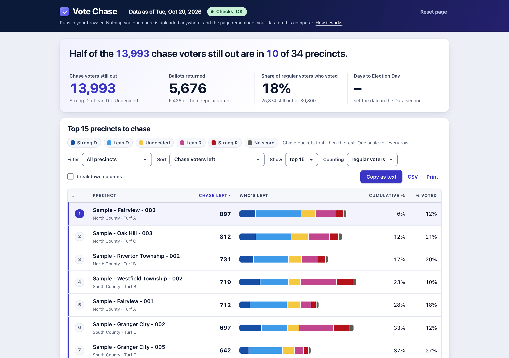

# Vote Chase

Vote Chase is a web page for field programs. It answers one question: **in which precincts are the most Democratic-leaning and persuadable voters who have not voted yet?**

You give it count reports from VAN. It ranks every precinct by the number of voters still worth contacting, shows who is left in each precinct by support score, and lets you filter by county or turf and copy, print or download the list for the morning meeting.



**How it works, in one paragraph.** VAN can count voters by precinct and by support score. You run that count twice: once for everyone who is registered, once for everyone who has already returned a ballot. The page subtracts the second from the first, precinct by precinct and score by score. What remains is the number of voters in each precinct who have not voted yet, split into groups such as Strong Democrat, Lean Democrat and Undecided. The groups you mark as worth chasing add up to the ranking.

**What it does not do.** It does not store, send or see any voter's name. It reads count reports only, on your own computer, in your web browser. There is no account, no server and nothing to install. Files you load are kept in that browser so the page is ready the next time you open it; a **Reset page** button removes them.

## Try it with sample data

1. Download the page: open [`index.html`](index.html) in this repository and use the download button, or use the green **Code** button → **Download ZIP** for the whole folder.
2. Double-click `index.html`. It opens in your web browser.
3. Open the **Update data** section and click **Load sample data**. The precincts are invented. Click **Reset page** when you are done.

A hosted copy at [ai-dems.github.io/ai-dems-gotv-tools/tools/vote-chase](https://ai-dems.github.io/ai-dems-gotv-tools/tools/vote-chase/) opens the same page with no download. It behaves exactly like the downloaded file: your data stays in your browser and is not sent to the host.

## The VAN reports it needs

The page uses up to four count reports. Each is a saved VAN search exported as a **crosstab**, which is VAN's name for a table with one row per precinct and one column per support-score band. [docs/van-searches.md](docs/van-searches.md) gives the exact filters and clicks.

| Report | Who is counted | How often to pull it |
|---|---|---|
| **Returned** | Everyone who has returned a ballot (voted early or by mail). | Every morning |
| **Registered** | Every active registered voter, whether or not they have voted. | Once, then again after the registration deadline |
| **Returned, regular voters** | Everyone who has returned a ballot **and** voted in the 2022 general election or the 2024 general election. | Every morning |
| **Registered, regular voters** | Every active registered voter **who also voted in the 2022 or 2024 general election**, that is, people with recent voting history. | Once, then after the deadline |

The first two are enough to start. The two "regular voters" reports let the page count only people with recent voting history, which leaves out registrants who never vote and gives a more realistic picture of who can still be turned out. Use the same suppression setting on every pull, so the reports describe the same population.

## Setup in five minutes

You need a VAN login that can run searches and open Counts. Nothing else.

1. **Build and save the two basic searches in VAN** (returned, and registered), following [docs/van-searches.md](docs/van-searches.md).
2. **Export each one as a crosstab.** Run the search. Open **Counts**. On the Counts page, set *Crosstab 1* to your support score (for example `2026: DNC Dem Party Support`), set *Column 1* to `Precinct`, and change the *People from* dropdown from "Registered Voters" to **My List**, so VAN counts the people in your search rather than everyone in the committee. Click **Refresh Results**, then **Export To Excel**. VAN saves a file named `DemographicsNew.xls` to your Downloads folder; rename it `returned.xls` or `registered.xls` so you can tell them apart.
3. **Load the two files into the page.** Open `index.html`, open the **Update data** section, and drag each file onto its box (or click the box and choose the file). The **Checks** label under the title should read "Checks: OK". If it does not, it says what to look at.
4. **Match the score groups to your score.** Open **Score groups**. The default is five groups on a 0 to 100 Democratic support score: Strong D (80 and up), Lean D (60 to 79), Undecided (40 to 59), Lean R (20 to 39), Strong R (0 to 19). Presets for four and three groups are built in, and each group's cutoff, name and colour can be changed. Tick the groups that count as "chase"; by default those are Strong D, Lean D and Undecided.

Then build the two "regular voters" searches and load them the same way. Once they are in, the **Counting** menu on the page lets you switch between all registered voters and regular voters.

## Using it day to day

- **Each morning**, export the *Returned* report (and *Returned, regular voters*) again and drop the new files on the page. The registered reports do not change until the registration deadline.
- **The headline** says how many chase voters are still out and how few precincts hold half of them. **The table** ranks precincts by chase voters left, with a bar showing who is left in each. [docs/metrics.md](docs/metrics.md) defines every number.
- **Filter** narrows the list to one county, turf or organizer once you have loaded a precinct groups file, a small spreadsheet that says which precinct belongs to which group ([docs/setup.md](docs/setup.md#precinct-groups)).
- **Copy as text** copies the top of the list for Slack or a text message. **CSV** downloads it as a spreadsheet. **Print** prints it.
- **History** keeps the totals from each day's pull, so you can see returns climb.

**Working as a team.** The page keeps your data inside the web browser on the computer where you loaded it. It is not shared automatically: a colleague who opens the page on their own laptop sees an empty page until they load the files too. To share your loaded data, click **Download workspace**, which saves everything (the reports, your score groups, the history) as one file, send that file, and have your colleague click **Load workspace**. If the whole team should see the same numbers every morning without anyone doing this, use the automatic pull described below.

If something looks wrong, [docs/troubleshooting.md](docs/troubleshooting.md) lists every message the page can show and what to do about it.

## Advanced: automatic VAN pulls

A campaign can have the page refreshed every morning with nobody opening VAN. A small program called the **runner**, installed on one campaign laptop, signs in to VoteBuilder, runs the four saved searches, exports the four crosstabs, checks each file, and writes the results into the folder where the page lives. Everyone who opens the page then sees that morning's numbers.

It needs a VoteBuilder login, a laptop that stays on, and Node.js, a free program that runs the runner's code (installed from nodejs.org in a couple of minutes; the instructions cover it). Setting it up takes about 15 minutes and a few commands typed into the computer's terminal, so it is a job for whoever on the campaign is comfortable doing that. Because it runs a script against VoteBuilder, read [docs/security.md](docs/security.md) first and check with your VAN administrator that your committee is comfortable with it. The setup steps are in [docs/automation.md](docs/automation.md).

## Repo contents

```
index.html        the page: plain HTML and JavaScript in one file, no dependencies
docs/             setup, the VAN searches, what the numbers mean, the file formats, automation, security, troubleshooting
runner/           optional: the scheduled VAN exporter (Node.js and Playwright) and the data.js converter
runner/test/      tests of the page (in a headless browser) and of the runner
```

## Maintaining

`npm test` at this level runs every test (the page in headless Chromium through its `window.VoteChase` interface, plus the runner's unit tests). The page needs no build step: a change to `index.html` on `main` is the release. Keep `data.js` and every VAN export out of the repository; `.gitignore` covers the runner's local folders.
